# Praxis Monitor

[](https://github.com/GabrielMProjects/praxis-monitor/actions/workflows/ci.yml)
[](https://github.com/GabrielMProjects/praxis-monitor/actions/workflows/security.yml)


**Real-time patient and room monitoring dashboard** for a medical practice, built with Java, Spring Boot, Flutter, WebSockets and a PriorityQueue-based triage queue.

> **Technical demonstration only – not a medical product.** The urgency levels (`CRITICAL`…`LOW`) are a purely technical demo rule, *not* a clinically validated triage system. **All patient data is synthetic** (generated demo names); no real patient data and no external services are used. Authentication, a persistent database and cloud deployment are intentionally out of scope. See [Known limitations](#known-limitations).

## Application Demo

https://github.com/user-attachments/assets/5e8d77bc-292e-411b-906e-b0b34947b422

[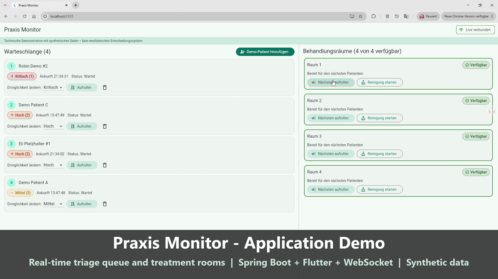](docs/demo/praxis-monitor-application-demo-1080p.mp4)

Demo video: about 70 seconds, 1080p, no sound. The player above is hosted by GitHub; no installation or sign-in is required. If it does not load, [download the MP4 (1.4 MB)](docs/demo/praxis-monitor-application-demo-1080p.mp4) from this repository.

This is a **recording of the application running locally** (Spring Boot backend on port 8080, Flutter web UI on port 5555). It is a demo video, **not a publicly hosted live application**.

What the video shows:

- the **triage queue** ordered by urgency (CRITICAL → HIGH → MEDIUM → LOW, first come first served within a level),
- **adding a synthetic demo patient** and **changing a patient's urgency**, which re-sorts the queue immediately,
- **calling a patient into a treatment room** (room becomes *occupied*), **completing the treatment** and **cleaning the room** until it is *available* again,
- the **"Live verbunden" (live connected) indicator**: all changes are pushed in real time over STOMP/WebSocket.

All patient names in the video are **synthetic demo data**; no real patient data is involved. The UI language is German.

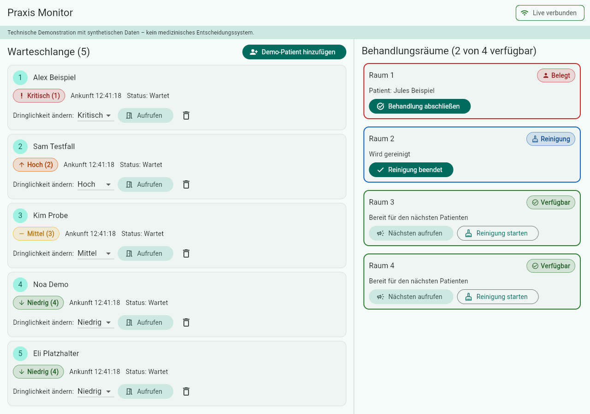

## Why this project

A portfolio project for e-health roles that shows, end to end and verifiably:

- a **hand-built priority queue** (`PriorityQueue` + explicit `Comparator` + arrival sequence) with honest complexity analysis,
- a **clean layered backend** (domain without framework dependencies, domain events, STOMP publisher),
- a **feature-first Flutter app with BLoC**, one shared WebSocket, automatic reconnect and REST re-sync,
- **consistency under concurrency** (atomic multi-step operations, tested with racing threads),
- **automated quality gates**: unit, integration, widget, architecture and real browser end-to-end tests, CI and security scanning.

## Screenshots

| Queue with all urgency levels | Treatment rooms |
|---|---|
| 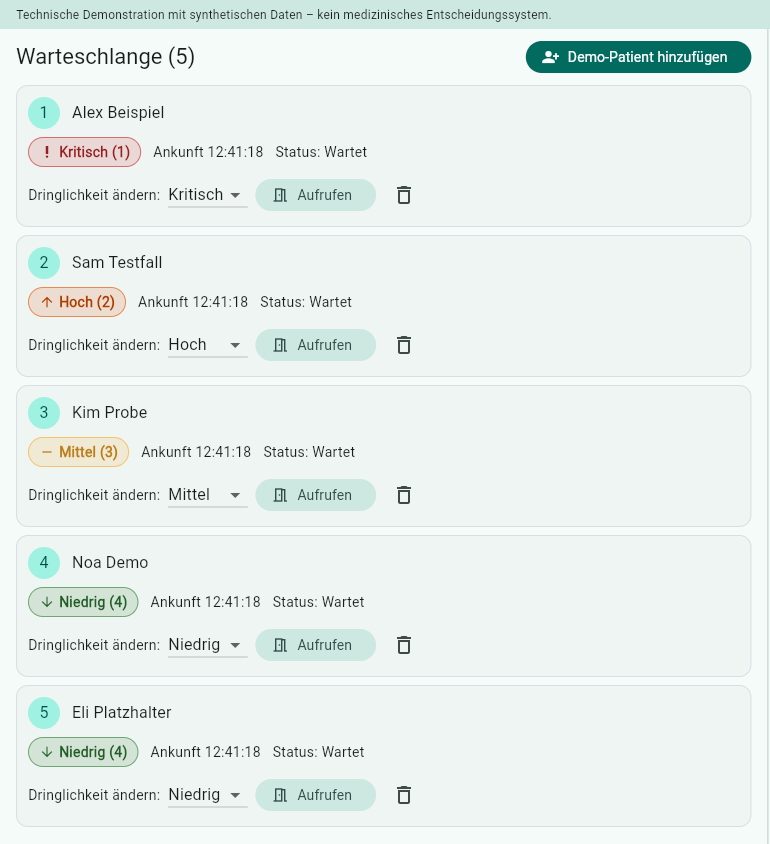 | 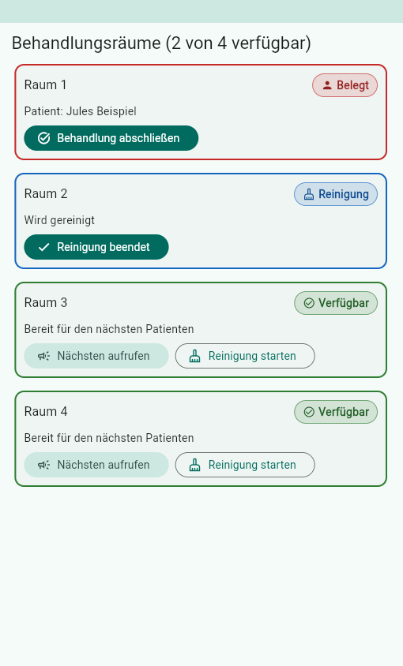 |

| Assign a patient to a room | Connection lost (auto-reconnect) |
|---|---|
| 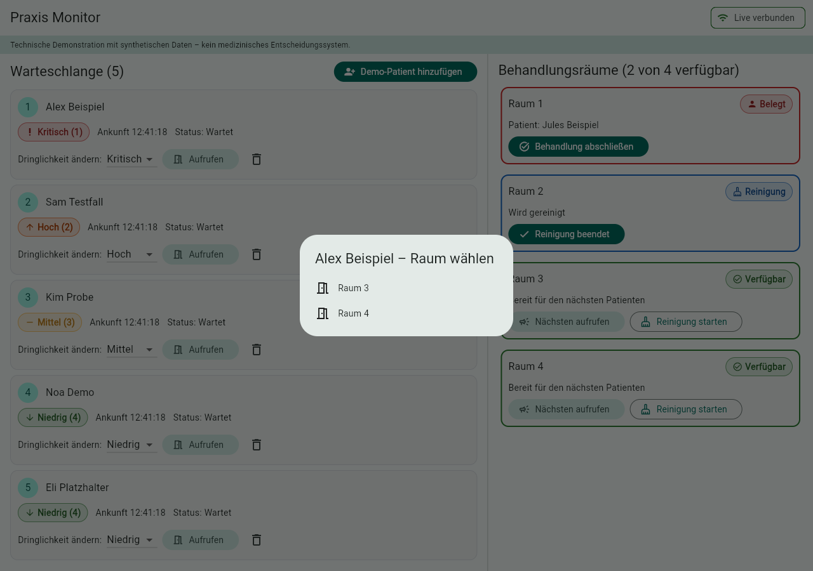 | 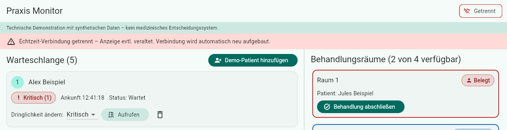 |

| Responsive: queue (phone) | Responsive: rooms (phone) |
|---|---|
| 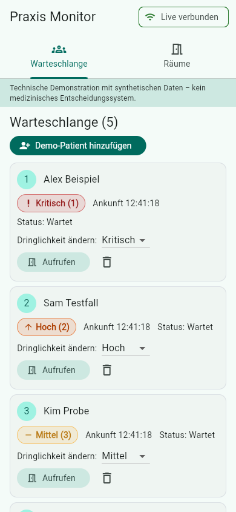 | 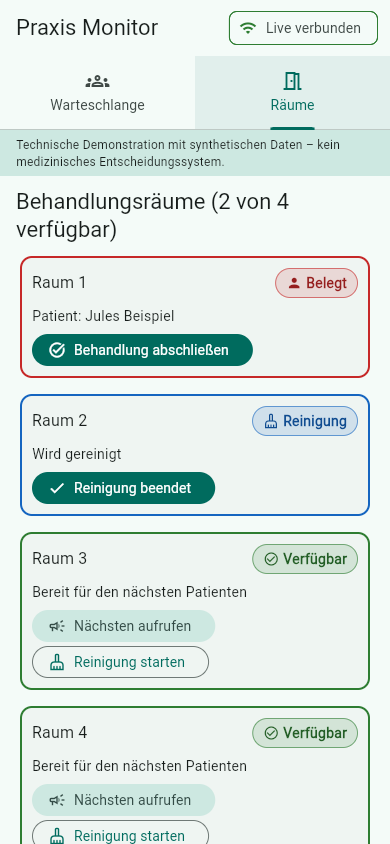 |

> The user interface language is German (the target audience of the demo); code, API and this README are English.

## Features

- **Patients:** create, edit (name/urgency while waiting), remove; validated input (`name` ≤ 80 chars, `urgency` enum).
- **Triage queue:** CRITICAL(1) → HIGH(2) → MEDIUM(3) → LOW(4); **FIFO within the same urgency**; urgency change keeps the original arrival rank.
- **Rooms:** `AVAILABLE → OCCUPIED → CLEANING → AVAILABLE` (cleaning must be finished explicitly; rooms never free themselves).
- **Treatment flow:** call next / assign a specific patient → complete treatment → clean → release.
- **Real time:** every change is pushed over STOMP/WebSocket to all open dashboards; **automatic reconnect** and REST re-sync after an outage.
- **Dashboard:** responsive (two columns ≥ 900 px, tabs below), status never by colour alone (text + icon), keyboard operable with visible focus ring, semantic labels and live regions for screen readers, loading / error / empty states.
- **Robustness:** central error handling (400/404/409/500 with a uniform JSON body, no internal details leaked), security headers, bounded in-memory history.

## Technology stack

| Area | Technology |
|---|---|
| Backend | Java 21, Spring Boot 4.1.2, Spring Web MVC, Spring WebSocket (STOMP), Bean Validation, Maven (wrapper included) |
| Frontend | Flutter 3.50 / Dart 3.14, `flutter_bloc`, `equatable`, `http`, `stomp_dart_client` |
| Tests | JUnit 5, MockMvc, STOMP client tests; `flutter_test`, `bloc_test`, `mocktail`; Chrome DevTools Protocol E2E (Node, no extra packages) |
| CI / security | GitHub Actions, CodeQL, gitleaks, Dependabot, dependency review |

## Architecture

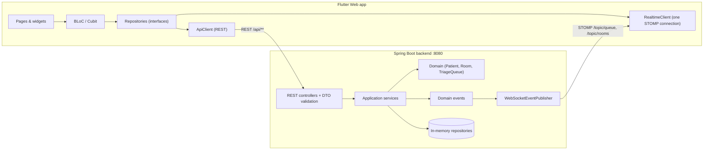

### Backend (`backend/src/main/java/com/praxismonitor`)

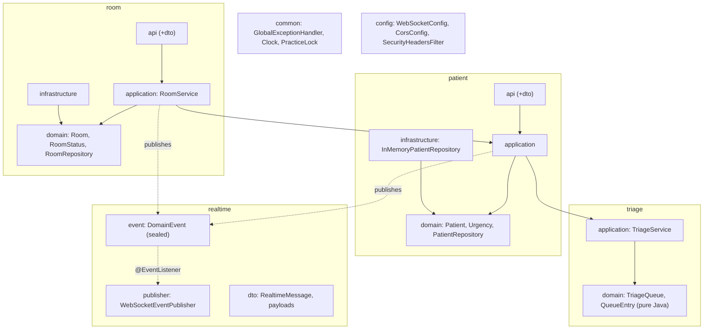

Rules: domain classes know neither Spring, REST nor WebSocket; services never touch WebSocket (they publish domain events); only `WebSocketEventPublisher` uses STOMP. Details: [docs/architecture.md](docs/architecture.md) and the [ADRs](docs/adr).

### Frontend (`frontend/lib`, feature-first)

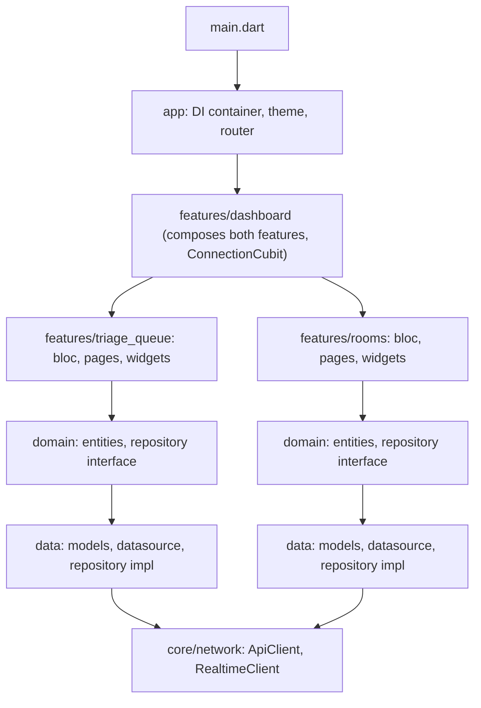

The two features **never import each other**; only the dashboard wires them together (enforced by `frontend/test/architecture_test.dart`). Widgets never call HTTP or WebSocket directly.

### REST and WebSocket data flow

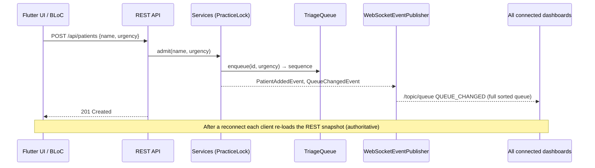

### Patient and room states

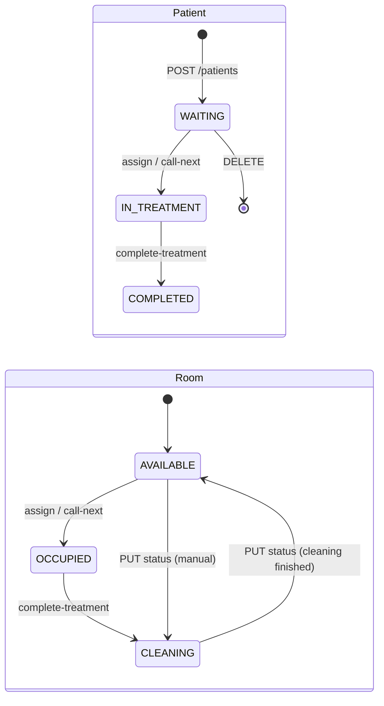

Forbidden transitions answer `409 Conflict` with a readable message (e.g. occupying an occupied room, completing in a free room, editing a patient in treatment).

### Triage algorithm (PriorityQueue + Comparator + FIFO)

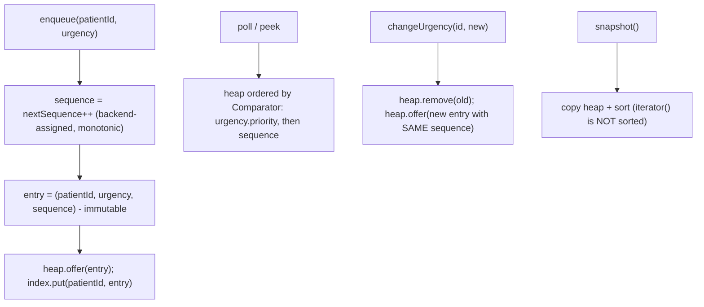

**Why a sequence number?** Java's `PriorityQueue` is not stable: equal elements may come out in any order. `QueueEntry.ORDER = comparingInt(urgency.priority()).thenComparingLong(sequence)` makes the order total and deterministic, so patients with the same urgency are served first-come-first-served. The sequence is assigned by the **backend** – client clocks can never influence the order; `arrivedAt` (UTC `Instant`) is display-only. A `HashMap` index guarantees heap and index always contain exactly the same entries (no stale entries).

| Operation (n = waiting patients) | Time | Notes |
|---|---|---|
| `enqueue` | O(log n) | `offer` + `put` |
| `peek` / `contains` | O(1) | |
| `poll` | O(log n) | |
| `remove(id)` | **O(n)** | `PriorityQueue.remove(Object)` searches linearly |
| `changeUrgency` | **O(n)** | remove + offer, sequence kept |
| `snapshot` | O(n log n) | copy + sort |
| memory | O(n) | heap + map (+ O(n) per snapshot) |

The linear removal is deliberate for practice-sized queues; alternatives (indexed heap, lazy deletion, `TreeSet`) are compared in [ADR-001](docs/adr/001-priority-queue.md).

## REST API (`http://localhost:8080`)

| Method | Path | Description | Success | Errors |
|---|---|---|---|---|
| POST | `/api/patients` | admit `{ "name", "urgency" }` | 201 + `Location` | 400 |
| GET | `/api/patients[?status=…]` | all patients | 200 | 400 |
| GET / PUT / DELETE | `/api/patients/{id}` | read / edit (WAITING only) / remove | 200 / 200 / 204 | 400, 404, 409 |
| GET | `/api/queue` | sorted waiting queue with `queuePosition` | 200 | – |
| GET | `/api/rooms`, `/api/rooms/{id}` | rooms | 200 | 404 |
| PUT | `/api/rooms/{id}/status` | `{ "status": "CLEANING" \| "AVAILABLE" }` | 200 | 400, 404, 409 |
| POST | `/api/rooms/{id}/assign` | `{ "patientId" }` | 200 | 400, 404, 409 |
| POST | `/api/rooms/{id}/call-next` | call the queue head into the room | 200 | 404, 409 |
| POST | `/api/rooms/{id}/complete-treatment` | patient COMPLETED, room → CLEANING | 200 | 404, 409 |

Error body (all 4xx/5xx): `{ "timestamp", "status", "error", "message", "details": [] }`. Full examples: [docs/architecture.md](docs/architecture.md#rest-api).

## WebSocket (STOMP)

Handshake `ws://localhost:8080/ws` (plain WebSocket, no SockJS), server → client only, heartbeat 10 s.

| Topic | Event `type` | Payload |
|---|---|---|
| `/topic/queue` | `PATIENT_ADDED` | patient |
| | `PATIENT_REMOVED` | `{ patientId }` |
| | `PATIENT_URGENCY_CHANGED` | `{ patient, previousUrgency }` |
| | `QUEUE_CHANGED` | `{ patients: [...] }` – **complete, sorted queue** |
| `/topic/rooms` | `ROOM_STATUS_CHANGED` | room |
| | `PATIENT_ASSIGNED` | `{ patient, room }` |

Envelope: `{ "type", "occurredAt", "payload" }`. `QUEUE_CHANGED` is authoritative; clients replace their list and never sort themselves.

## BLoC state management

`TriageQueueBloc` and `RoomsBloc` expose `initial → loading → loaded | failure` plus a transient `actionError` (e.g. a 409 shown as snackbar without losing the list). Repositories expose `watch…()` streams that deliver WebSocket updates **and** a REST snapshot after every (re)connect; the BLoCs subscribe first, then load, re-read via REST after each user action (correct even when the socket is down) and cancel subscriptions in `close()`. `ConnectionCubit` mirrors the single shared WebSocket for the UI banner.

## Clean code and SOLID in practice

- **S**: `Room`/`Patient` own their state transitions; services orchestrate; controllers only map HTTP.
- **O**: `DomainEvent` is `sealed`, so a new event type forces the publisher `switch` to be extended (compile-time).
- **L/I**: small focused interfaces (`PatientRepository`, `RoomRepository`, `RealtimeClient`).
- **D**: services depend on repository interfaces and an injected `Clock`; Flutter composition root (`AppDependencies`) injects fakes in tests.
- Immutable records, invariants in constructors, validation before the first write, one coarse lock for multi-structure operations ([ADR-004](docs/adr/004-in-memory-and-single-lock.md)).

## Getting started (Windows)

**Prerequisites:** JDK 21, Flutter SDK (stable, tested with 3.50.0), Git for Windows, a browser. Maven is not needed (wrapper included). For the browser E2E tests and screenshots additionally Node ≥ 22 and Chrome.

```powershell
git clone https://github.com/GabrielMProjects/praxis-monitor.git
cd praxis-monitor
.\scripts\demo.ps1          # starts backend (8080) + Flutter web (5555) and opens the browser
```

`demo.ps1` detects an already running backend on port 8080 and reuses it (never stops it), reports port conflicts with a clear message, starts the Spring Boot backend with the `dev` profile (three synthetic demo patients) and the Flutter app, and writes logs to `.demo/`. Flutter is found via `PATH`, `$env:FLUTTER_BIN` or `%USERPROFILE%\tools\flutter\bin`.

### Stop

```powershell
.\scripts\stop-demo.ps1             # stops what demo.ps1 started
.\scripts\stop-demo.ps1 -Backend    # also stops a backend on 8080 that demo.ps1 did not start
```

### Manual start

```powershell
cd backend;  .\mvnw.cmd spring-boot:run "-Dspring-boot.run.profiles=dev"      # http://localhost:8080
cd frontend; flutter pub get; flutter run -d chrome                              # new terminal
```

Other backend port: `--dart-define=API_BASE_URL=http://localhost:8081 --dart-define=WS_URL=ws://localhost:8081/ws`. Configuration: `backend/src/main/resources/application.yml` (+ `application-dev.yml`, active only with `SPRING_PROFILES_ACTIVE=dev`).

## Tests

```powershell
cd backend;  .\mvnw.cmd clean verify                  # unit, service, REST and WebSocket integration tests
cd frontend; flutter analyze; flutter test            # BLoC, repository, widget and architecture tests
.\scripts\e2e.ps1                                     # data-stack E2E: real jar + real Flutter repositories/BLoCs (incl. reconnect)
.\scripts\e2e-browser.ps1                             # browser E2E: real Flutter UI in headless Chrome (incl. reconnect)
# Linux/macOS/CI: bash scripts/e2e.sh
```

### Verified results (executed locally on Windows 10, 2026-11)

| Suite | Result |
|---|---|
| Backend `mvnw clean test` | **60 tests passed** (triage 18, patient service 12, room service 12 incl. race of 16 threads for one room, REST 12, error handling/500 path 2, WebSocket 3, context 1) |
| `flutter analyze` | **no issues** |
| `flutter test` | **70 tests passed** (BLoCs, repositories, `StompRealtimeClient`, widgets, architecture rules) |
| Data-stack E2E (`scripts\e2e.ps1`, also via `bash scripts/e2e.sh`) | **7/7 passed** (real jar, sort/FIFO, rooms, backend kill → reconnect, no duplicate subscriptions) |
| Browser E2E (`scripts\e2e-browser.ps1`, also via `bash scripts/e2e.sh`) | **15/15 steps passed** (mouse + keyboard, dialog/Esc, focus order, 375 px layout, live updates, backend kill → reconnect + resync) |

The exact status per requirement, including what was **not** tested, is documented in [docs/requirements-matrix.md](docs/requirements-matrix.md).

## Continuous integration

`.github/workflows/ci.yml` (free GitHub-hosted runners, read-only token, concurrency cancels outdated runs, timeouts on every job, all actions pinned to commit SHAs) and `.github/workflows/security.yml`:

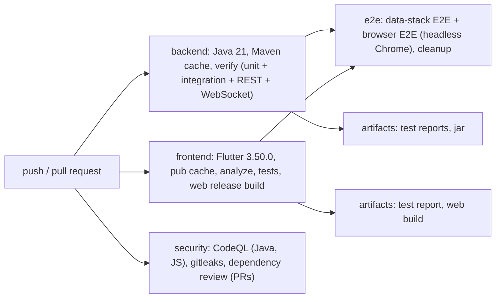

> **Status:** the CI and Security workflows pass on `main` on GitHub-hosted Ubuntu runners (backend, Flutter analyze/tests/web build, data-stack and browser E2E, CodeQL for Java and JavaScript, full-history gitleaks scan). The workflow files can also be checked offline with `scripts/validate-workflows.dart` (YAML syntax, SHA pinning, permissions, timeouts). The *Dependency review* job runs on pull requests only and needs the repository's dependency graph (Dependabot alerts) to be enabled.

## Security measures

- Input validation (Bean Validation), enum parsing errors → 400, uniform error body; unexpected errors → generic 500 without internals (tested).
- CORS and WebSocket handshake accept only configured local origin patterns (`http://localhost:*`, `http://127.0.0.1:*`), foreign origins are rejected (tested).
- Security headers on every response, `Cache-Control: no-store` on `/api/**`.
- No secrets in the repository; gitleaks in CI; Dependabot (Maven, pub, Actions); CodeQL; dependency review on PRs; minimal workflow permissions; no `pull_request_target`; actions pinned by SHA.
- Dev profile only on explicit request; demo data only in `dev`.
- Node: the E2E tooling uses Node's built-ins only (no npm dependencies, hence nothing to audit).

## Known limitations

- **No authentication/authorization, no TLS** – local demo only; never expose it to a network with real data.
- **In-memory data**, single instance; restart = empty. Completed patients are bounded (`praxis.history.max-completed-patients`, default 100, oldest evicted).
- One coarse lock serialises all mutations (simple and correct; not for high throughput).
- `remove`/`changeUrgency` in the queue are O(n) (see above).
- `Room.patientName` is a display snapshot taken at assignment.
- UI strings are German; no i18n.
- Not verified: real screen readers (NVDA/Narrator), browser zoom 200 %, browsers other than Chromium, Windows desktop target.
- The documentation under `docs/` is written in German.

## Documentation

[Architecture](docs/architecture.md) · [ADRs](docs/adr) · [Requirements matrix & test evidence](docs/requirements-matrix.md) · [Demo guide](docs/demo-guide.md) · [Recording plan](docs/recording-plan.md)

## License

**Proprietary – all rights reserved** (see [LICENSE](LICENSE)). The source is publicly visible for review (e.g. by recruiters and potential employers) but is **not open source**: no permission to use, copy, modify, distribute or use it commercially is granted beyond viewing and the forking that GitHub's Terms of Service allow for public repositories. Previously granted and legally effective license rights remain unaffected. The software is provided "as is"; it is a technical demonstration and must not be used for real patient care.
